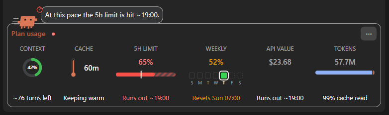
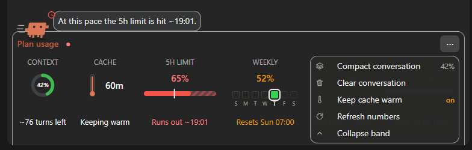
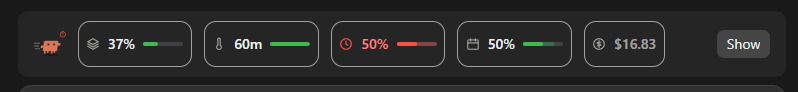

# claude-mods

Claude Code mods by [ReesMehorst](https://github.com/ReesMehorst).

## Install

```
/plugin marketplace add ReesMehorst/claude-mods
/plugin install usage-band@reesmehorst
/plugin install github-pane@reesmehorst
/plugin install test-pane@reesmehorst
```

Answer `y` to add the marketplace, then pick a scope.

## Mods

### usage-band

A band above the prompt that shows where your session stands, with a small orange mascot
that tells you the one thing worth doing next.



**The mascot** (desktop, VS Code, mobile) stands on the band's edge. Its mood follows the most
urgent thing, and its bubble offers the one action that fits, with *Later* to hide it:

|  |  |  |  |  |  |  |  |
|:-:|:-:|:-:|:-:|:-:|:-:|:-:|:-:|
| Cache warm | Turn running | Cache running out<br>*Keep it warm* | Keep-warm on | Cache cold<br>*Turn on keep-warm* | Context filling<br>*Compact now* | Limit on pace past 100% | Budget nearly spent |

**Segments**, one row, each with a picture and at most one short line:

- **Context**: a ring; *~N turns left* (to 80%) or *Time to compact*.
- **Cache**: a thermometer that drains as the prompt cache's lifetime runs out; *Keeping warm*,
  *Running out* or *Expired*.
- **5h limit** (plan): a bar with what is used, a hatched forecast of where the window lands at
  this pace and a tick for now; *Runs out ~HH:mm* or *Resets HH:mm*.
- **Weekly** (plan): seven day tiles in GitHub greens, brighter for a heavier day, today ringed.
  The tiles come from samples taken at the end of each turn while the mod runs (kept across
  sessions), so days without Claude Code open stay blank.
- **API value** (plan): what the session would cost on API credits; *Runs out ~HH:mm* for the
  first limit you are on pace to hit.
- **Spend** (API credits with a budget): a fuel gauge, green to 75%, amber to 90%, red after;
  *Runs out ~HH:mm* or *Over budget*. Without a budget, spend with `$/hr`.
- **Tokens**: a split bar of cache reads, new input and output; *xx% cache read*.

The **⋯** button opens the band's actions:



**Collapse band** (or `/usage-band`) folds it to one line of chips, the mascot still in its
mood; *Show* brings the band back, and the choice is remembered:



**Plan vs API**: the band says "Plan usage" once your subscription reports rate limits, "API
usage" once something is billed without them, and "Usage" before either. A plan never talks
budget and API never talks pace; on API credits the keep-warm suggestion says the pings are billed.

**Monthly spend**: `/spent` shows what the month has cost so far: *API spend* for turns billed on
API credits, and *Plan usage* (the same turns at API prices, included in your plan) for turns on a
subscription, plus where the month lands at the pace so far once three days are tracked. Each
finished turn adds its own cost to a total kept across sessions, so it counts only what the mod
saw: days before you installed it, or with Claude Code open without it, are not in the sum (the
header says *tracked since* the first day). A new month starts from zero.

**Prompt cache and keep-warm**: the cache your chat rides on lapses after 5 minutes, or 1 hour
when it was written that way; the next message then re-caches the whole context. A toast warns
before it lapses and when it has (not while the context is under 20k tokens,
*Cache alert minimum*). `/keep-warm on`, the dropdown or *Keep prompt cache warm* under `/config`
sends a tiny tool-less ping shortly before the lapse, which renews it. A ping is a cache read of
your context plus one word out, billed to the session and counted in `/cost`: cheaper than
re-caching, not free. At most 3 per idle stretch (*Keep-warm pings per idle stretch*), reset by
your next message. Pings never fire mid-turn or once the cache is already cold.

**Warnings** as toasts on every surface: context at 80%, a limit on pace past 100%, spend at 90%
of budget. On API credits, *API budget (USD)* and *Expensive turn warning (USD)* under `/config`
set the budget and a per-turn cost toast.

**Terminal**: the same data as a text band, with `━━━───` bars: limits with `pace → 120%` and
`hits 100% ~16:40`, spend with `$/hr`, context, tokens and the cache countdown. `/usage-band`
toggles a one-line view there too.

### github-pane

`/github` opens a live pane for the repo you're in (needs the [`gh`](https://cli.github.com) CLI, signed in).

- **This branch**: the PR for your checked-out branch, pinned above the tabs.
- Tabs: **Pull requests**, **Checks** (workflow runs), **Issues**, **For me**
  (review requests, your PRs, issues assigned to you), **Notifications** (unread, this repo).
  Hotkeys `1`–`5`, `r` refresh.
  In the desktop app the tabs are one segmented row with a count pill each (red when the tab
  has failing items); in a narrow pane they become a full-width **View** dropdown and rows drop the branch.
- Each row: CI status, title, branch → base, author, review state, age.
  In the desktop app a row is two lines, with review and CI as coloured pills; a selected
  row opens a card under it with its actions and details: the PR description as formatted
  markdown, reviewers with a state pill each, failed logs and checks in a code block.
- Select a row for actions: open on GitHub, `c` checkout a PR, `x` rerun failed jobs,
  `l` show the failed-step log inline, `e` mark a notification read.
- On a failed run or PR: `f` **Fix with Claude** puts the failed log and a fix request in
  the prompt box as a draft. Nothing is sent until you press Enter.
- On a PR: `d` details (diff stat, mergeable state, reviewers, description), `a` approve
  (not on your own PRs), `y` mark a draft ready, `m` squash-merge and delete the branch.
  Merge asks for a second `m` press; changing the selection or Close cancels it. In the
  desktop app the first press shows a confirm card with Merge and Cancel instead.
- Desktop app: a full-width **Filter** field above the list (click it, then type; ctrl+U clears) narrows the tab by title, `#n`, branch or
  author; switching tabs clears it. An empty tab says why it is empty.
- Refreshes every 60 s while the pane is open, with toasts when a PR's checks turn red,
  your review is requested, your PR is approved, or a run on your PR's branch finishes.
  Errors back off (up to 10 min); no repo or `gh` signed out pauses polling until `r`.


### test-pane

A live pane of the tests Claude runs through Bash. It opens by itself on the first test run
of a session (closing it keeps it closed; `/tests` brings it back).

- **Picks up** pytest, jest, vitest, `go test`, `cargo test`, `node --test`, mocha, `bun test`,
  `deno test`, and `npm`/`pnpm`/`yarn test` scripts (plus make, rspec, gradle and the like,
  counted from their summary line). Background runs are skipped.
- **Per test**: failures first, then a skipped count and a folded *N passed* list (`p`);
  *Output* (`o`) shows the last 40 lines of the run.
- **Flaky**: a test that both passed and failed with no file edited in between gets a
  *flaky* pill and a toast; the pane lists every flaky test of the session. Edits are counted
  from Edit/Write calls and from Bash commands that may write.
- **Rerun failed** (`x`) builds a command for just the failing tests from the run's own
  command (`pytest -v ids`, `-t` for jest/vitest/bun, `-run` for go, `--exact` for cargo,
  `--test-name-pattern`, `--grep`, `--filter`) and runs it in the session's folder.
  **Rerun all** (`a`) repeats the command. Pane reruns are listed with the rest.
- **Fix with Claude** (`f`) puts the failing names (flaky ones set apart) and the output tail
  in the prompt box as a draft. Nothing is sent until you press Enter.
- The last 8 of up to 30 runs sit at the bottom; pick one to view it, *Clear* empties the list.

## Develop

```
claude plugin validate ./usage-band
claude plugin test ./usage-band
```
